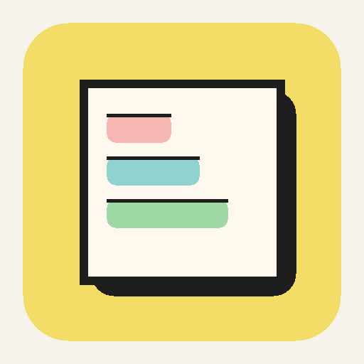
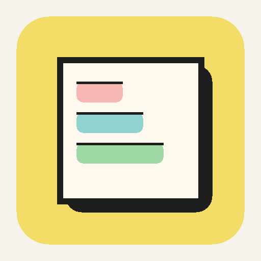

# UniPartner — Your Local Student Companion

UniPartner is a local-first, offline-ready academic companion designed for university students. Built with Flutter, Provider, and custom Neo-Brutalism design principles, UniPartner provides centralized course management, timetable scheduling, attendance tracking, assignment/exam reminders, and GPA/CGPA calculations without requiring cloud servers, external APIs, or internet connectivity.

## Overview

University students frequently manage fragmented schedules, attendance cutoffs, assignment deadlines, and GPA goals across multiple disconnected tools. Existing university management portals are often slow, require persistent connectivity, and lack personal productivity features.

UniPartner solves this problem by providing a private, student-centric workspace that operates 100% on-device. Students enter their academic structure once during a guided 6-step onboarding wizard, after which UniPartner's deterministic intelligence engine automatically computes daily briefings, attendance safety margins, class reminders, and target GPA requirements.

## Screenshots

<div align="center">
  
  
  
</div>

<br/>

<div align="center">
  
  
  
</div>

<br/>

<div align="center">
  
  
  
</div>

<br/>

<div align="center">
  
  
  
</div>

<br/>

<div align="center">
  
  
  
</div>

<br/>

<div align="center">
  
</div>

| Screen | Description |
| --- | --- |
| **Authentication & Splash** | Branded launch screen and secure local account login/registration screens. |
| **First-Time Setup** | 6-step progressive wizard configuring profile, term dates, courses, timetable, and initial attendance. |
| **Dashboard** | Real-time academic overview featuring the rule-based Daily Smart Briefing engine. |
| **Timetable** | Weekly schedule organized by day chips with class room and time slot indicators. |
| **Attendance** | Class ratio tracking showing required recovery classes or safe miss allowances toward 75%. |
| **Assignments & Exams** | Deadline management with priority badges, status filters, and local push notifications. |
| **GPA / CGPA Calculator** | Semester GPA, cumulative CGPA tracking, and target GPA projection calculator. |
| **Settings & Profile Hub** | Centralized management hub for editing student profile, term timeline, and course logs. |

## Features

### Authentication & Local Security
- **PBKDF2-HMAC-SHA256 Encryption:** Secure local password derivation using OWASP-compliant 600,000 iterations and 16-byte random salt.
- **Android Keystore Integration:** Sensitive authentication keys and session tokens are encrypted on-device via `FlutterSecureStorage`.
- **Constant-Time Verification:** Password comparison algorithm designed to prevent side-channel timing attacks.
- **Form Validation:** Strict client-side validation requiring minimum length, letter, and number rules.

### Onboarding & Central Course Management
- **6-Step Setup Wizard:** Onboarding wizard guiding students through profile setup, semester dates, subject creation, timetable slot mapping, and initial attendance logging.
- **Single Source of Truth:** Central `Course` catalog. Timetable slots and attendance records link directly to `Course.id` via stable foreign keys.

### Intelligence & Scheduling
- **Daily Smart Briefing:** Deterministic rule-based engine that evaluates student data every morning, prioritizing overdue tasks, upcoming exams (within 7 days), assignments due, low attendance alerts, and today's class schedule.
- **Smart Attendance Planner:** Mathematical engine calculating exact consecutive classes required to reach 75% attendance or maximum safe classes allowed to miss.
- **Local Push Notifications:** Scheduled local reminders for upcoming exams (24h/1h prior), assignment deadlines (24h prior), and weekly class start times (15m prior) using `flutter_local_notifications` and device timezones.

### Academic Analytics & Planning
- **GPA & Cumulative CGPA Tracker:** Calculates semester GPA and multi-semester CGPA using quality points.
- **GPA Target Calculator:** Computes the required future GPA needed to achieve a target CGPA given completed and expected credit hours.

### Isolated University Task Module
- **Firebase Auth Task:** An isolated module (`lib/firebase_task/`) providing email/password registration and login demonstration via `firebase_auth`, completely decoupled from UniPartner's main offline local storage.

## Tech Stack

| Area | Technology |
| --- | --- |
| **Framework** | Flutter (`3.47.2`) / Dart (`3.13.2`) |
| **State Management** | Provider (`^6.1.2`) |
| **Local Data Persistence** | `SharedPreferences` (`^2.5.5`) |
| **Secure Key Storage** | `FlutterSecureStorage` (`^9.2.2`) |
| **Cryptography** | `crypto` (`^3.0.6`) — PBKDF2-HMAC-SHA256 |
| **Local Notifications** | `flutter_local_notifications` (`^22.3.1`), `timezone` (`^0.11.1`), `flutter_timezone` (`^5.1.0`) |
| **Design System** | Custom Neo-Brutalism (warm cream surfaces, 2px borders, offset shadows) |
| **Branding Generators** | `flutter_launcher_icons` (`^0.14.3`), `flutter_native_splash` (`^2.4.4`) |
| **Isolated Task Module** | `firebase_core` (`^3.12.1`), `firebase_auth` (`^5.5.1`) |

## Architecture

UniPartner utilizes a layered, feature-modular architecture. Presentation widgets observe reactive providers (`AuthProvider` and `AppDataProvider`), which manage domain models and handle persistence services asynchronously.

```text
lib/
├── firebase_task/             # Isolated university Firebase Auth task module
│   ├── firebase_auth_service.dart
│   ├── firebase_home_screen.dart
│   ├── firebase_login_screen.dart
│   └── firebase_register_screen.dart
├── models/                    # Immutable data models & JSON serialization
│   ├── assignment_model.dart
│   ├── attendance_model.dart
│   ├── course_model.dart
│   ├── exam_model.dart
│   ├── semester_model.dart
│   ├── semester_settings_model.dart
│   ├── timetable_model.dart
│   └── user_model.dart
├── providers/                 # Reactive state management layer
│   ├── app_data_provider.dart
│   └── auth_provider.dart
├── screens/                   # UI presentation layer
│   ├── assignments/
│   ├── attendance/
│   ├── auth/
│   ├── courses/
│   ├── dashboard/
│   ├── exams/
│   ├── gpa/
│   ├── onboarding/
│   ├── profile/
│   ├── settings/
│   ├── timetable/
│   └── main_screen.dart
├── services/                  # Platform services (Crypto & Notifications)
│   ├── notification_service.dart
│   └── password_hasher.dart
├── utils/                     # Global theme, GPA math, constants
│   ├── gpa_calculator.dart
│   └── theme.dart
├── widgets/                   # Reusable UI components (NeoCard, DashboardCard)
│   ├── dashboard_card.dart
│   └── neo_card.dart
└── main.dart                  # Application entry point & Auth Gate
```

## How It Works

```text
Student Interaction ──> UI Widgets ──> Provider (AppDataProvider / AuthProvider)
                                                  │
                       ┌──────────────────────────┴──────────────────────────┐
                       ▼                                                     ▼
         Encrypted Keys & Session                              Academic Data & Settings
      (FlutterSecureStorage / Keystore)                           (SharedPreferences)
```

1. **Authentication:** `AuthProvider` validates credentials locally using `PasswordHasher.deriveHash()`, comparing PBKDF2 hashes in constant time and storing active session markers in `FlutterSecureStorage`.
2. **Data Propagation:** UI widgets observe `AppDataProvider` using `context.watch<AppDataProvider>()`. Mutations (e.g. adding a class or marking attendance) update in-memory state, trigger UI re-renders via `notifyListeners()`, and serialize asynchronously to `SharedPreferences`.
3. **Relational Links:** `TimetableEntry` and `AttendanceCourse` maintain `courseId` references pointing to `Course.id`, ensuring renames or updates in central course management propagate smoothly.

## Notable Engineering Details

- **OWASP-Compliant Key Derivation:** Implemented custom PBKDF2 key derivation using HMAC-SHA256 over 600,000 iterations to protect on-device passwords against dictionary attacks.
- **Constant-Time Hash Comparison:** Verifies password hashes using bitwise XOR accumulation (`PasswordHasher.constantTimeCompare`) to eliminate timing side-channel vulnerabilities.
- **Relational Foreign Key Integrity:** `TimetableEntry` and `AttendanceCourse` store nullable `courseId` foreign keys with fallback to `courseName`, preserving full backward compatibility with older offline records.
- **Deterministic Intelligence Engine:** Daily Briefing and Attendance Target algorithms evaluate student status mathematically on-device without remote server dependencies.
- **Custom Neo-Brutalist Component System:** Built a custom reusable component library (`NeoCard`, `NeoTheme`) incorporating `#1E1E1E` stroke borders, solid offset shadows, and responsive layouts.

## Getting Started

### Prerequisites

- Flutter SDK (`>= 3.13.2`)
- Android Studio / Xcode (for mobile emulators or devices)
- Java Development Kit (JDK 17 or 21)

### Clone the Repository

```bash
git clone https://github.com/mohsin715786/uni_partner.git
cd uni_partner
```

### Install Dependencies

```bash
flutter pub get
```

### Run the Application

```bash
flutter run
```

### Build Debug APK

```bash
flutter build apk --debug
```

## Testing

Run static code analysis:

```bash
flutter analyze
```

Run unit and widget tests:

```bash
flutter test
```

## Project Status

**Completed Portfolio & University Project.**
UniPartner is fully functional as a local-first student productivity app. All core modules (local auth, onboarding setup, central courses, timetable, attendance, assignments, exams, GPA, notifications, and custom theme) are implemented and tested.

## Future Improvements

- **Data Export & Import:** Backup and restore academic records via encrypted JSON files.
- **Homescreen Widgets:** Android/iOS native home screen widgets for next class and daily briefing highlights.
- **Biometric Lock:** Optional Fingerprint/FaceID lock screen backed by local secure storage.

## What I Learned

- Implementing OWASP-compliant password hashing (`PBKDF2-HMAC-SHA256`) and managing on-device encrypted storage using `FlutterSecureStorage`.
- Designing a local-first application architecture with relational data models linked by stable foreign keys.
- Building a progressive 6-step setup wizard that populates central state models cleanly without duplicating data.
- Scheduling and synchronizing local notifications across Android timezones using `flutter_local_notifications`.
- Creating a unified, custom Neo-Brutalist design system in Flutter.

## License

This project is open source under the MIT License. See the [LICENSE](LICENSE) file for details.

## Author

**Muhammad Mohsin Ghafoor**

- **GitHub:** [mohsin715786](https://github.com/mohsin715786)
- **LinkedIn:** [Muhammad Mohsin Ghafoor](https://www.linkedin.com/in/muhammad-mohsin-ghafoor/)
- **Portfolio:** [mohsin-zeta.vercel.app](https://mohsin-zeta.vercel.app/)
